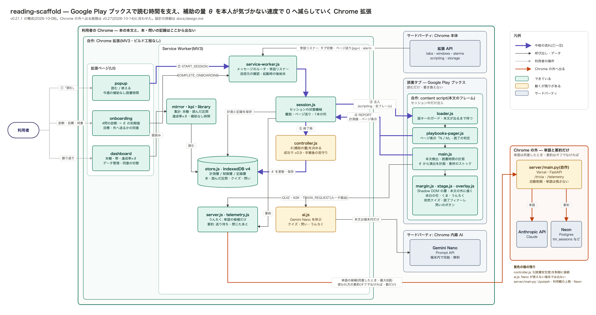
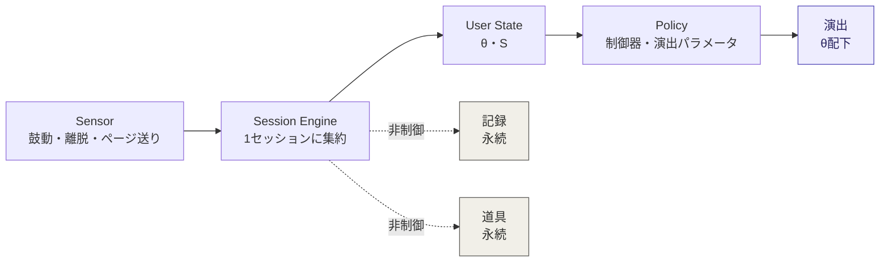
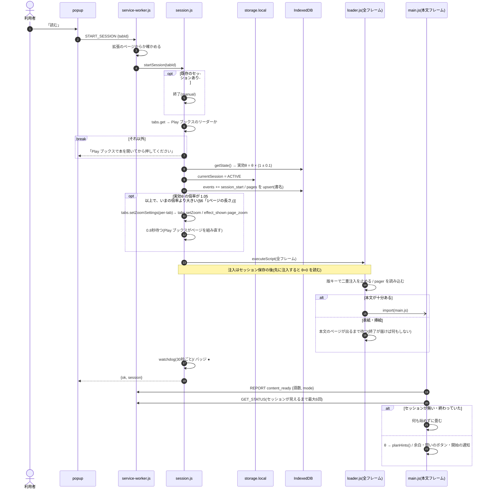
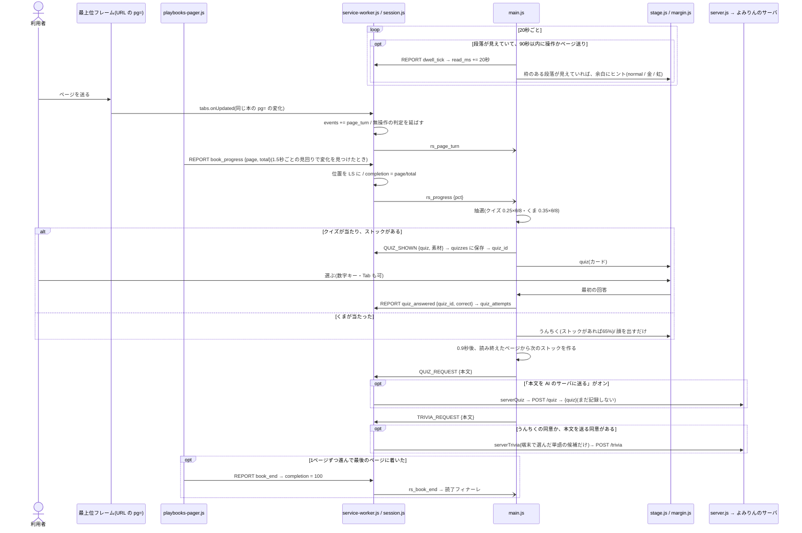
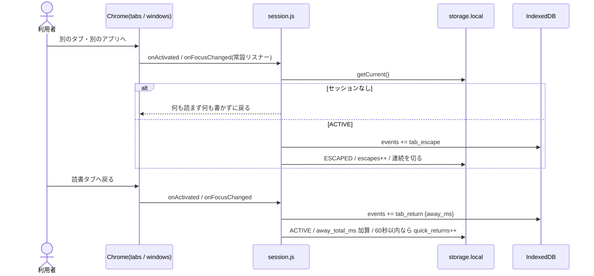
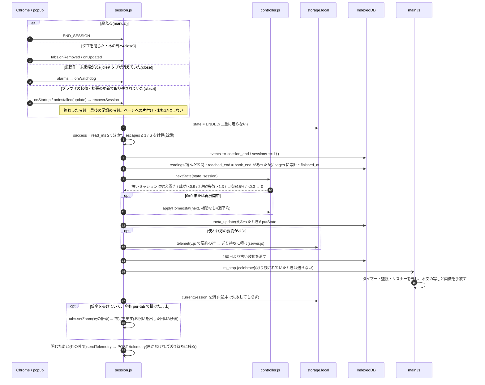
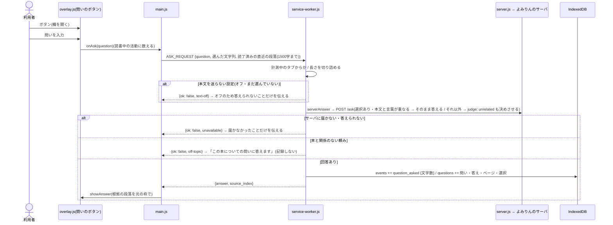
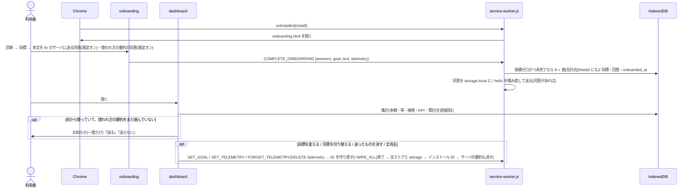

# 設計: reading-scaffold

- **Status:** 唯一の設計書(2026-10-08)。architecture-v1・data-design v2・reward-design・ask-and-nano-design・overview を統合した。旧版は [archive/](archive/)
- **対応コード:** v0.21.1。現物(いまの仕組み)だけを書く。これから作るものの設計は [GitHub の issue](https://github.com/yukik8/yomirin/issues) に書き、作り終えた PR でここへ移す
- **対象:** Google Play ブックス(ウェブ版)専用。Web 記事の経路はコードに一部残るが、開始できない
- **関連:** 公開の手順は [release.md](release.md)、利用者向けの説明は [../PRIVACY.md](../PRIVACY.md)、サーバは [../server/README.md](../server/README.md)、文献は [research/](research/)

---

## 0. ひとことで

読書中だけ動く Chrome 拡張。読む時間を支える補助(余白の花・くま・突然クイズといった演出)を出し、その量 θ を**本人が気づかない速度で減らしていく**。補助がゼロになっても読めていれば成功(卒業)。読んだ記録と「自分からの問い」は減らさずに残す。

「ドーパミン」は利用者向けのメタファーで、システム変数ではない。システムが制御するのは**足場の量 θ ただ一つ**で、その目標値は常に 0。

### θ とは

θ は「本文1,000語(日本語は1,000字)あたり、ヒント・演出を何回出すか」を表す1本の数字。範囲は 0〜8。

| θ | 1,000字あたりの演出 | 地のきらきら | 意味 |
|---|---|---|---|
| 8 | 約8回 | 最も多い | 最大。診断で最も補助が要る人の初期値 |
| 4 | 約4回 | θ=8 のときの1/4 | |
| 1 | 約1回 | θ=8 のときの1/64 | |
| 0 | 出ない(クイズ・くま・フィナーレも出ない) | 出ない | 卒業。自分からの問いと記録は残る |

- **初期値:** オンボーディングの4問診断で 2〜8 に置く。以後 θ を動かすのは制御器だけ
- **動き方:** 成功したセッション(5分以上読み、離脱1回以下)ごとに 10% 減る。2回続けて失敗したら 30% 戻す。1日の変化は ±15% まで。0.3 を切ったら 0(卒業)。失敗がなければ 8 から成功32回、週3回で約11週
- **見せ方:** 変化は通知しない。セッションごとに ±10% の揺らぎを乗せて、下がる傾向を隠す。読書中の画面には θ を出さない(ストア版は開始の通知からも外す)。推移は本人がダッシュボードを開けば見られる

---

## 1. 三分法と、漸減する軸は一本だけ

すべての機能は次の三つのどれかに属する。どれにも属さない機能は作らない。両方の性質を持つものも作らない。

| | 演出(stimulus) | 記録(record) | 道具(tool) |
|---|---|---|---|
| 何 | 余白の花・地のきらきら・くま・うんちく・突然クイズ・読了フィナーレ・1ページの長さ(タブの倍率) | 本棚・帯・読んだ区間・余白(問いとクイズ)・累計 | 自分からの問い |
| 起点 | システム(θ+乱数) | 蓄積 | 本人 |
| θとの関係 | **θ配下。θとともに漸減し、卒業(θ=0)で消える** | 非制御。永続 | 非制御。永続 |
| 可変報酬 | あり(乱数・レア度) | **禁止**(決定的な蓄積のみ) | **禁止**(回答に演出をつけない) |
| 住処 | 読書中のページ上(本文の外) | ダッシュボード | 読書中のページ上(小さく) |

理由: **タペリングできない刺激装置を作ってはいけない**(愛着の湧いたものはフェードアウトできない)。永続するものからは可変報酬のループを構造的に外す。

- くまはペットではなく**演出**。育たない・お腹が空かない・要求しない。θ=0 で出なくなる。ペットにするなら記録カテゴリ(読書中の視界の外・一方向の蓄積のみ)に置く(旧 reward-design の判断)
- 「注意支援・理解支援・報酬・記憶」を別々の制御器にはしない。n=1 で4つの方策は同定できず、「減らすもの」と「残すもの」の線は三分法で引けている。**θ以外を制御しない**

---

## 2. 構成



紫の太線 ①〜⑤ が中核の流れ(読む → 開始 → 注入 → 計測 → 終了時に θ を更新)。橙の線が端末の外へ出る唯一の経路(よみりんのサーバ)で、通るのは3つだけ(§9): 本人が「本文を AI のサーバに送る」をオンにしたときの、クイズと問いのための本文の一部(読み終えたページ・書いた問い)と、端末で選んだ単語の候補(最大8語)と、オフにしていなければ、閉じたセッションの要約(数・真偽・決まった語だけ。本・本文は含まない)。黄色の箱は動くが残りがあるもの。図はまだ端末内の Gemini Nano を描いている(v0.30 でやめた。§9)。図の元は [overview.svg](overview.svg)(素の SVG。直したら PNG を書き出し直す)。考え方だけを字を大きく描いたプレゼン用の一枚は [concept.png](concept.png)(元は [concept.svg](concept.svg)・16:9)。C4 の図(文脈・コンテナ・コンポーネント・配置)は [c4/](c4/)(PNG と、元の SVG)。

- **Play ブックスのフレーム:** 最上位は `play.google.com/books/reader`、本文とページ表示は `books.googleusercontent.com` のフレームの中。ローダーは全フレームに入り、本体(main.js)は本文のあるフレームでだけ動く
- **ビルド工程なし。** ES モジュールをそのまま読む。ストア版かどうかは manifest の `update_url` の有無で見分ける(`IS_STORE_BUILD`)

### 論理パイプライン



実線の列だけが制御ループ。記録と道具は θ を読まないし書かない。

---

## 3. セッションエンジン(session.js)

```
IDLE ──[読む(popup)]──▶ ACTIVE
ACTIVE ──[タブ切替/ウィンドウ非フォーカス]──▶ ESCAPED ──[復帰]──▶ ACTIVE
ACTIVE/ESCAPED ──[終える / タブを閉じる / 本の外へ移る / 無操作3分]──▶ ENDED
```

- **開始は popup から**(ユーザー操作)。Play ブックスのリーダー以外では開始しない。host 権限が Play ブックスにしか無いので、他のタブは URL も読めない
- **同じ本**は URL の `id=` で判定する。ページ送り(`pg=` の変化)は終了ではなく `page_turn`。別の本・Play ブックスの外へ移ったら終了
- 離脱はセッションを終わらせない(離脱→復帰が制御の主要シグナル)。復帰なし3分で自動終了
- **計測はセッション中のみ:** tabs 系リスナーは service-worker.js のトップレベルに常設し(MV3 の再起動要件)、全ハンドラは最初にセッションを確かめ、無ければ何も読まず何も書かずに戻る
- **現在値は `chrome.storage.local`**。SW の再起動もブラウザの終了も跨ぐ。ブラウザの起動時(`onStartup`)と拡張の更新時(`onInstalled: update`)に、取り残されたセッションを**最後の記録の時刻で**閉じる。閉じていた間は読書時間にも離脱時間にも数えない(v0.21.1)
- **1本の列:** currentSession を読んで書き戻す処理(報告・離脱・ページ送り・終了)は SW の中で直列に走らせる。並べないと読了の瞬間の報告どうしが上書きし合う
- **終了は二重に走らない:** 最初に `ENDED` を保存してから記録を書き、最後に必ず現在値を消す
- 終了時にすること: 成否の判定 → (成功かつ θ>0 なら)読了のお祝い → `sessions` に集計 → `readings`・`pages` に記録 → 制御器で θ を更新 → (同意があれば)使われ方の要約を送り待ちに積む → 古い細かい計測の掃除 → content に片付けを頼む → タブの倍率を戻す(§6「1ページの長さ」。お祝いを出した回は出し終えてから)。閉じたあと、列の外で送り待ちを送る(§9)
- **開始で倍率を掛けてから注入する(v0.29・#33):** 実効θ からタブの倍率を決めて掛けたら、Play ブックスがページを組み直すのを 0.8 秒待ってから content script を入れる(本文と位置は組み直した後のものを読む)。倍率を戻すのは、どの終わり方でも(注入に失敗した・取り残されたセッションの回収も)

### Sensor の操作的定義(main.js・playbooks-pager.js)

| 量 | 定義 |
|---|---|
| 読書時間 read_ms | 本文の段落が見えていて(IntersectionObserver 10%)、直近90秒以内に操作かページ送りがある間の、20秒の鼓動の合計。ページ送りの本は1ページ読む間に操作がないので、窓を90秒にしている |
| 離脱 escapes | タブ切替・ウィンドウ非フォーカスの回数。行き先は記録しない(読める権限がない) |
| 最長連続 longest_streak_ms | 鼓動が40秒以内に続き、離脱で切れない区間の最長 |
| 読了率 completion_pct | 本の中の位置(ページ表示 page/total)。段落の比率は使わない(読み込まれた分の中の位置なので途中でも100%になる) |
| 読了 | 1ページずつ進んで最後のページに着いたとき(pager の `book_end`)。スライダーや目次で飛んだ・最後のページで開き直した、は読了にしない |
| 読む速さ(v0.22) | ページを送るたびに、直前まで見えていた段落の語数と滞在時間(`page_read`)。離脱を挟んだページ・3秒未満・10分超・20語未満は標本にしない。セッションの終わりに 語数/分の中央値・変動係数・詰まった(中央値の1/2以下)/流した(2.5倍以上)ページ数を `sessions` に残す |
| 読み返し backs | ページ表示が前のページより手前へ動いた回数 |
| 本文 | ページ(`reader-rendered-page`)・EPUB の body(`.gb-segment`)の中で、文字をじかに持つブロック要素(p・div・見出し・li など。入れ子なら内側)の空でない段落(ルビの振り仮名は除く・`content/book-text.js`)。クラス名は本ごとに違うので使わない(青空文庫は `.main_text > div`、出版社の本は `p.para2` など)。3段落・200語未満なら measure-only(演出なし・計測のみ) |

- 表紙や挿絵のページで始めたときは、ローダーが本文のページが出るまで待ってから本体を入れる
- 先読みされて画面の外にあるページの段落も DOM にあるので、「見えている」は可視の監視で判定する。同じ段落が作り直されても、本文の文字列で同じ番号として扱う
- 問いのボタンの操作と入力は「読書中の活動」に数える(問いの最中に放置終了させない)

---

## 4. User State: θ と S

### θ(現物)

- 単一レコード `state`: `{ theta, success_streak, fail_streak, day, day_start_theta, diag_answers, theta0, goal, onboarded_at, homeostat?, stair?, last_decision?, pace? }`(`stair` は階段法の事後分布・§5、`pace` は読む速さの持ち越し `{ wpm, cv, pages, updated_at }`・§6、`theta0` は診断で置いた初期値。使われ方の要約の hello に載せるだけで、制御器は読まない・§9)
- **実効θ** = θ × (1 ± 0.1 の乱数)。日々±10%揺れる中を成功あたり10%下るので、下降がノイズに埋もれる(迷彩)
- **診断は事前分布を置くだけ:** 4問(各0〜2点)の合計 → `[2, 3, 4, 5, 5.5, 6, 7, 7.5, 8]`。セッションの実績が1つでもあれば、診断のやり直しは θ を触らない

### S(読書安定度)— 並走計測中(`SUCCESS.judge` で制御に接続できる)

二値の success(5分以上・離脱1回以下)は「20分読んで1回逸れた」と「5分ぎりぎり」を区別できない。Play ブックスでは5分の基準が緩く、θ と無関係に成功が並ぶ = 制御器に情報が届かない(replay の `flat` 読者)。S ∈ [0,1] を v0.14 から `sessions.stability` に並走で記録している。ルールベース(ML にしない)。

```
S = clamp( 0.45·dur + 0.25·escape + 0.15·return + 0.10·steady + 0.05·ending, 0, 1 )
dur     = min(read_min / 20, 1)
escape  = max(0, 1 − escapes/3) × max(0, 1 − away_total_ms/3分)
return  = 離脱のうち60秒以内に戻った割合(離脱なしは1)
steady  = max(0, 1 − 速さの変動係数)(標本が無ければ 0.5)
ending  = manual:1 / close:0.8 / idle:0.6
```

- v0.22 で `completion`(本の中の位置。その回の読み方と無関係に後半ほど高くなる)を `steady` に替え、`ending` の重みを下げた(終了ボタンを押したかどうかで成否が割れないように)
- **制御への接続:** `SUCCESS.judge = 'stability'` にすると、制御器は `outcomeOf` で S を3値に切って読む(S ≥ 0.7 成功・S ≤ 0.3 失敗・間は据え置き=学ばない)。既定は `'binary'`(v0.21 と同じ)。切り替えは並走データの一致率(`library.stabilityReport`)と replay を見てから

**S に入れないもの:** ヒント・演出の回数、クイズ正誤、問いの数、目標達成、連続日数、その他エンゲージメント指標。理解を制御に入れると「簡単な問題を出せば θ が下がる」自己目的化の回路ができる。理解は評価のガードレールにだけ使う(§10)。

---

## 5. 制御器(controller.js)

### タペリング(現物)

```
セッション終了ごとに:
  ごく短いセッション(読書1分未満・離脱なし = 誤って開始・本の切り替え)→ 成否に数えない
  success → success_streak++, fail_streak=0, θ ← θ×0.9      # 本人が気づける差(10〜20%)より小さい
  fail    → fail_streak++,    success_streak=0
  fail_streak ≥ 2 → θ ← θ×1.3                               # 戻すときは大きく(ヒステリシス)
  1日の総変化は ±15% まで
  θ < 0.3 → θ = 0(卒業。乗算は0に届かないのでスナップ)
```

### ホメオスタット(卒業後の見守り・v0.21.1)

- 卒業の瞬間に、補助なし読書時間(ヒント・演出ゼロのセッションの読書時間)の4週平均を**基準**として記録する
- 卒業(再卒業)から4週は見守るだけ(4週平均が卒業後の読書を映すまで待つ)。基準が0だったときは、4週たった時点の週平均を基準にする
- その後、4週平均が基準の **50%** を切ったら θ=1.5 へ一時再展開する(1日の変化幅の基準も1.5に置く)
- 再展開中も**通常の漸減は続く**(目標は常に0)。4週平均が基準の **80%** まで戻るか、漸減で0に着いたら再卒業
- 文献(research/fading.md): 乗算的な減衰は減薬の標準形式と同型。パンの減塩 RCT(週5%・累積25%で気づかれない)が「気づかれない漸減」の実証例

### 閾値推定(staircase.js・v0.22・`CONTROLLER.policy = 'staircase'` で有効)

固定則の弱点は、`tools/replay` の模擬読者で数字になる: 閾値の高い人(`heavy`)を**成功率4〜5割の θ に留め続ける**(×0.9 と ×1.3 の釣り合う点が p≈0.5)。一方で成功基準が緩い人(`flat`)には33回のタイマーにすぎない。

階段法は、その人の「θ がこれだけあれば読める」閾値 τ をセッションの成否からベイズ推定する(心理物理学の QUEST と同じ考え方。n=1・数十回で収束する)。

```
P(成功 | θ, τ) = γ + (1 − γ − λ) · σ((log θ − τ) / w)      γ=0.15 λ=0.1 w=0.5
事後分布は log θ のグリッド(0.05 〜 8×e^1.5・64点)上の重み。初期は一様(診断の θ は最初の量であって閾値の見込みではない)
目標点 θ* = exp(τ̂ + 余白)   余白 = w·logit((0.75 − γ)/(1 − γ − λ)) ≈ 閾値 × 2

成功 → θ ← θ×0.9(固定則と同じ。閾値から遠いあいだ、成功は「閾値はもっと下」としか言わない)
       ただし事後分布が狭く(sd ≤ 0.5)、θ×0.9 < θ* なら据え置き(閾値の余白の中では下げない)
失敗 → θ* > θ×1.05 なら θ ← θ*(= 最後に読めていた θ の記憶へ戻る)。閾値から遠い失敗は生活のノイズとして動かない
毎回、事後分布を sd 0.12 のガウス核でぼかす(忘却。据え置きが続いても失敗の記憶は薄れ、習慣で閾値が下がれば再び下り始める)
1日 ±15%・θ<0.3 で卒業 は固定則と同じ
```

- fading.md の推奨 ①(失敗時は最後に安定していた θ へ)②(卒業直前は刻みを細かく)は、この形に含まれる。③(再展開は低く始める)はホメオスタット側で未対応
- `STAIRCASE.exploreHoldP`(既定 0): 下げる場面でもこの確率で据え置き、「下げたせいで読めなくなったか」を後から比べられるようにする(micro-randomization)。卒業が遅れるので開発者のプロフィールでだけ使う
- 模擬読者での比較(replay、300人・16週): `heavy` の成功率 49% → 69%、`light`・`flat` は固定則と同じ、`typical` は成功率 73% → 78% と引き換えに12週以内の卒業が 54% → 24%(閾値を尊重するぶん遅い)。本物の記録では `replay --export` で θ の軌跡を比べる
- 日次±15% は文献の根拠がない。工学的な裁量と明記して残す

---

## 6. 演出(Play ブックス)

演出は**本文の外**に描く。読んでいる文字の上には何も重ねない。くまはポーズ集の色鉛筆と水彩の絵(`extension/assets/bear/`)、舞うものは水彩の粒(paint.js が形を一度だけ焼き、毎フレームは位置と透明度だけを変える)。ふだんは静かに、大きく画面を覆うのは突然クイズ・章の終わり・読了フィナーレの決まった瞬間だけ(見た目の決まりは [style.md](style.md))。

### 余白(margin.js)と、読書中の派手さ(v0.25・`READING_FX`)

原則(2026-10-09・[style.md](style.md) §0): **派手さは動きの速さではなく色・量・広さで出す。動かすのは目が文章から離れる瞬間(めくり中・章の終わり)だけ。読んでいる時間の報酬は「世界が育っていること」で表し、手が止まっても何も減らさない**(考えて止まる時間も読書。「色が薄くなる」は続けろメーターになる)。予告で残りのページ数は示さない。

- 本文の枠の外の帯(縦書きは上下、横書きは左右)から描く場所を選び、描くたびに本文の枠を切り抜く
- **めくった合図は3つの入口から拾い、いちばん早いもので1回だけ動く:** 初めての段落が見えた(本文フレームの中・IntersectionObserver)/ SW からの `rs_page_turn`(タブの URL の変化。新しいページが出たあとに届くことがある)/ めくりのキー。1.2秒以内の合図は同じめくり。開いた直後の2秒は合図にしない。めくりの光はすぐ、余白の飾りと章の区切りは新しいページの段落が見えてから(0.7秒後)。段落の番号は読み込んだ順に振るので、最深段落の増加ではめくりを拾わない(本の順と一致するとは限らない)。開発版はコンソールに `[よみりん演出]` で記録を残す
- **Micro(めくり中):** めくりの光。画面の上下の縁を細い虹が走り、0.6秒で消える。確率 0.2 × θ/8、20秒以上空ける
- **Meso(読書中・静止)— よみりんの小さなストーリー(2026-10-10・`stories.js`・`story.js`・`READING_FX.story`):** 画面の右下の角で、無言のくまが一つのものを作り進める(本を積む・パンケーキを重ねる・風船を集める…の18話。絵はストーリー集 ① から `tools/story-sprites/cut.py` で切り抜いた `extension/assets/story/<話>-<コマ>.webp`)。何を作っているのかも、あと何コマかも説明しない
  - **進み方:** 1コマ目は最初のめくりで必ず出る(6秒に満たなくても。話があることにすぐ気づけるように)。そのあとは、6秒以上読んだページをめくるたびに、確率 (0.12 + 0.33 × θ/8) × 話の進みやすさ で1コマ進む(θ/8 × 0.15 で2コマ)。何もない回が続くこともある(進捗バーにしない)。コマが替わるのはめくった瞬間だけで、0.9秒でふわっと替わって静止
  - **限界:** 最後から2つ目のコマまで来たら、そこで止まって待つ。最後のコマはオチ
  - **置き場所:** 右の余白の帯が 90px 以上あればその下の方(右下の問いのボタンの上)、無ければ下の余白の右寄せ(高さ 64px 以上)。本文の枠には決してかけない。入らなければ置かない(話は見えないまま進む)。一度置いたら動かさない(めくっている最中は段落が一瞬消えたり2ページ分が重なったりするので、めくるたびに測り直すと点滅する。置き直すのは、画面の大きさが変わったときと、0.8秒落ち着いた本文の枠が話にかかったときだけ)。コマの入れ替えは、新しいコマを上に重ねて出し、前のコマは半分出てから消す(途中でくまが薄くならない)。同じ話のコマは同じ倍率で描く(切り抜いた絵の 0.9 倍 × (0.6 + 0.4 × θ/8)、入らなければ縮める)。話がある間、隅のくまは左から出る
  - **選び方:** 章ごとに乱数で1話(直前と同じ話は避ける)。作ったものは持ち越さない(セッションをまたがない・完成した話の一覧も作らない)。オチたあとの物(寝ているくま・仕上がった物)は、次にちゃんと読んだページをめくった瞬間に消え、次の話が何も無い所から始まる
  - 縁の光は章の区切りから12回のめくりで最も濃くなる(めくった瞬間に4秒かけて)。見開きは2ページで1回のめくり
  - 散らばる余白の飾り(芽・葉・花・銀の星・一緒に読むくま)は、「溜まった感」が出ないので止めてある(`READING_FX.garden.enabled`。戻せる)
- **ヒント(θの枠):** 段落が見えた瞬間(=めくった瞬間)に、余白の飾りとして話の近くに置く。normal は花(散らばる飾りを止めている間は何も置かない)、rare は金の花3つと金のきらきら、epic は虹のかけらと金のきらきらに、くまが画面を斜めに駆け抜ける(0.7秒・幕なし)。副経路・天井・先触れの保証など、めくっていない時に出たヒントは、次にめくるまで取っておく。文字のカードは出さない
- **予告(Meso):** レア以上が3ページほど先(見えている段落の数 × 3)に待つと、めくるたびに静かな印が一つ増える(話のオブジェクトの左か上に、少し重ねて。近くが埋まっていれば置かない)。レア: 金の星 → 金の星 / 激レア: 金の星 → 金の星 → くまの耳(画面の下の縁から)→ 虹のかけら。印を置いたレアは、その段落に着けば必ず出る(外れ予告は無い)
- **Macro(章の終わり):** めくった先が章の始まり(いま見えている最初の段落が h1〜h3 か、本文より字が1.3倍以上大きい30字以内の行)で、前の章を3ページ以上読んでいたら、**よみりんの話がオチて**、余白の飾りと縁の光が真ん中へ吸い込まれ(0.4秒)、フィーバー「〇〇 読了!!」(終わった章の見出しが10字以内なら。分からなければ「章 読了!!」)。締めは本を開く。数秒で本に戻る。見出しが一度も見つからない本は、話が限界で2〜4めくり待ったら自分でオチて区切る(話が無いときは12ページごと)。帯に言葉は出さない。オチ〜フィーバーの間はクイズやくまを割り込ませない
  - **オチ:** 限界まで来ていれば最後のコマに替えてから、話ごとの型で動く(0.7〜1.6秒)。boom 膨らんで震えて弾ける(本積み・星集め)/ collapse ぐらっと傾いて崩れる(パンケーキ・謎タワー)/ crumble 崩れた絵に替わってぺしゃっと潰れる(雪だるま)/ fly 揺れながら上へ飛んでいく(風船)/ sail 横へ滑って画面の外へ(紙の船)/ complete きらっと光る(雲作り・謎の植物・盆栽・旗立て・虹建設)/ pop ぴょんと出てくる(本のお城・段ボール・謎の箱)/ **stay** そのまま — フィーバーはくま抜きで、寝ている・食べている・絡まっているくまが画面の端に残る(寝床・クッキー・毛糸)。全部を派手な成功にしない
  - **たまった分だけの解放:** 章が先に終われば、途中のコマのままオチる。章のフィーバーの大きさは θ/8 × (0.55 + 0.45 × 溜まった割合)(限界まで来ていれば θ のまま)。本の読了のフィナーレは話に関係なく θ のまま(話はオチる)
- **地のきらきら**(読書中に1.5秒ごとに星が瞬く)は、読んでいる瞬間に動くので Play ブックスでは出さない(`READING_FX.still`。false で前の版の舞う演出に戻る)

### 1ページの長さ(PAGE_ZOOM・zoom.js・v0.29・#33)

演出が出るのはめくった瞬間なので、1ページ(見開きなら1,000〜1,500字)を読み切れない人には、θ=8 でも何も届かない(2026-10-15 のドッグフーディング。手で ⌘+ を押してページを短くしたら読めた)。そこで「1ページの長さ」そのものを、θ とともに外れていく補助にする。

- **⌘+ と同じブラウザの倍率**(`chrome.tabs.setZoom`)を、セッションの開始で実効θから決めて掛ける: 倍率 = 1 + (`PAGE_ZOOM.max` − 1) × θ/8(max は仮に 1.6)。1.05 未満(θ が約0.7未満)なら掛けない。θ=0 では掛けない。いまの倍率がそれ以上なら何もしない(本人が自分で大きくしている)
- **ページの DOM には触らない**(不変条件1)。Play ブックスが自分でページを組み直す(窓が狭くなるので見開きは1ページになる)。余白の演出も同じ倍率で大きく映り、余白の帯は狭くなる(入らなければ置かない・§6 の各節のとおり)
- **このタブだけ**(`setZoomSettings` の `scope: 'per-tab'`)。Play ブックスの他のタブや、次に開いたときに残さない。per-tab にできなければ掛けない(per-origin のまま掛けると、Play ブックスの倍率として保存されて残る)。per-tab の倍率は、タブが別の文書へ移る・再読み込み・ブラウザの再起動で Chrome が戻す
- **戻す:** 終わるとき(どの終わり方でも・取り残されたセッションの回収も)、このタブが今も per-tab で倍率が掛けたままなら、元の倍率と設定に戻す。本人が途中で ⌘+/⌘− していた・Chrome が戻していた・タブが無い、なら触らない(起動し直したあとに番号が使い回された別のタブにも触らない)。お祝いを出した回は出し終えてから戻す(3秒・組み直しで花が本文にかからないように)。その間に次のセッションが始まったら、先に戻してから始める
- **新しい権限も常設リスナーも足さない。** `tabs.setZoom` は権限なしで呼べる(manifest と release.md の申告はそのまま)。本人が変えたかどうかは終わるときに比べるだけ(`onZoomChange` は使わない・不変条件2)
- **数え方:** 掛けた回は `effect_shown { effect_id: 'page_zoom', factor }` を1回記録し、`effects_shown` を1増やす(補助なしの回に数えない)。制御器の入力は変えない(不変条件3)。外へ送るものも増えない(使われ方の要約の `effects_shown` に1が乗るだけ)
- **読む速さの計測はそのまま。** 読む速さ(語/分)は、字の大きさが広い範囲で変わってもほぼ同じ(Legge らの読書の心理物理)。ページの語数と滞在時間が一緒に縮むだけなので、`page_read`・`state.pace`・読む速さに合わせた出し方は変えない
- 総ページ数が倍率で変わるので、本の中の位置は比で換算する(§8「本の中の位置の尺度」)
- 開発版の θ のダイヤルで、倍率もその場で変わる(本人が途中で変えていたら触らない)
- **やらないこと:** 本文のフレームに CSS を差し込んで文字だけ大きくする(ページの改変・Play ブックスのページ割りと食い違う)/ Play ブックスの「表示オプション」を拡張から操作する(本人の設定を書き換える・アカウントで同期されうる)/ 倍率を読書中の画面に出す・「文字が小さくなりました」と知らせる

### めくった直後の出来事(PAGE_EVENTS・stage.js)

ページを送るたびに抽選し、当たれば出す(出たり出なかったりする=可変報酬)。開始から2回のめくりまでは何も起きない。出す時刻は、本人の読む速さが分かっているかで変わる(下の「読む速さに合わせた出し方」)。

| 出来事 | 1回のめくりで出る確率 | 間隔 | 中身 |
|---|---|---|---|
| 突然クイズ | 0.25 × θ/8 | 2分以上 | 画面全体のカードに3択。間違えても「おしい!」で選び直せる。正解で花火・花びら・ことば吹雪 |
| くま | 0.35 × θ/8 | 45秒以上・クイズの後20秒は出さない | 画面の隅(下の縁か左右の縁)から顔を出す。65%でうんちくを一言、それ以外は顔を出すだけ。顔を出すだけのときは、出方の大きさを余白のヒントと同じ確率でロールする(ふつう=いろいろな出方・まばたき・耳ぴこ / レア=小物と一緒・金の星 / 激レア=積読の上・虹の星。記録は `effect_shown` の `bear_rare` / `bear_epic`)。先触れは無い |

- クイズは生成に数秒かかるので、**読み終えたページ**(既読で、いま見えていない段落・最大1,500字)から先に作ってストックしておき、めくった 0.6 秒後に出す。未読のページからは作らない(ネタバレ禁止)
- 速さが分からないうちは、うんちくも同じ(前のページから作ってストック、めくった直後に「さっきのページの「語」より」)
- ストックは古くなったら捨てる(クイズ6めくり・うんちく4めくり)。作れなかったら3めくり空けてから作り直す

#### 読む速さに合わせた出し方(v0.24・`PAGE_EVENTS.paced`)

「前のページの話を、めくった直後に」ではなく、「いま読んでいるページの語の話を、その語を確実に読み過ぎた頃に」出す。

- **速さの推定:** このセッションの標本(`page_read` と同じ語数/滞在時間、同じ絞り)と、前回までの持ち越し `state.pace`(語/分の中央値・変動係数・ページ数。セッションの終わりに 6 ページ分の重みで混ぜる)を、ページ数で重み付き平均する。合わせて 3 ページ分の標本が無ければ使わない(従来の出し方)
- **位置の推定:** めくってからの時間 × 速さ。語の位置は、いま見えている段落を読む順に並べて、その語が最初に出る所までの語数
- **出す時刻:** 本人の速さの 0.8 倍で読んでいるとして、語を読み終える時刻に、変動係数の分(cv × 1.0)だけさらに遅らせる。めくってから 4 秒未満には出さない。本人の速さそのままでのページの終わりの 8 秒手前より遅くなるなら出さず、次のめくりで「さっきのページの」として出す(持ち越しは 1 めくりまで)。150 秒より先の予定は立てない
- **素材:** 当たったときに、いま見えているページ(最大1,500字)から端末で単語の候補を選び、サーバで作る(§9)。語が本文に見つからない・生成が遅かった、も次のめくりに持ち越す(ネタバレをしない側に倒す)
- **顔を出すだけ:** ページの 45% を読み過ぎた頃(同じ遅らせ方。6 割にすると、遅らせた分でページの終わりに掛かって出なくなる)
- 抽選・頻度・派手さは変えない(θ 配下のまま)。速さの推定は計測・制御・記録には使わない。記録には `hint_shown.timing`(`turn` / `paced`)を残す

#### くまの置き場所

画面の下の左右どちらかに出す。本文の枠(いま見えている段落の矩形)と重なる面積が小さい側を選び、同じなら読んでいる推定位置から遠い側(横書きの見開きは前半が左ページなので前半は右に、縦書きは逆)。推定が無ければ左右は乱数。吹き出しは出した側に付く
- クイズは**出したときに記録する**(先に作っただけの問題は本棚に残さない)
- 派手さは intensity(θ/8)に比例する。θ が高いほど祭り、低いほど静か
- めくるたびに花びらを降らせる演出(PAGE_SHOWER)と、紙の角がめくれる演出(PAGE_CURL)は、読書の邪魔だったので止めてある

### 読了フィナーレ・章の終わり・クイズ正解(フィーバー)

読了は、1ページずつ進んで最後のページに着いたあと、その次の「読み終えた」画面(You've just finished)に進んだ瞬間に1回だけ(2026-10-09。最後のページで出すと、まだ読んでいる途中に出てしまう)。拾い方は2つ: 見開きでページ表示が「17–20 / 20」→「20 / 20」に変わった(pager の `book_end_screen`)か、本文の段落が画面から0.6秒消えた。読了の記録(`book_end_at`)は今までどおり最後のページに着いた時点。章の終わりは、めくった先が章の始まりのとき(上の Macro)。クイズは正解した瞬間。どれも θ=0 では出さない。

ふだんの画面(記録・道具・隅のくま)を静かにしておき、この2つの瞬間だけを思いきり派手にする(2026-10-09。地が静かなほど、ピークの予測誤差が大きい)。くまはポーズ集から切り抜いた絵(`extension/assets/bear/`・`tools/bear-sprites/cut.py`)を、stage.js の台本(時刻ごとの位置・伸び縮み・回転・絵の差し替え)で動かす。派手さは intensity(θ/8)で4段に分ける:

| 段 | θ の目安 | 動き |
|---|---|---|
| 4 | 6.4 以上 | **打ち上げ:** 下から顔を出す → 驚く → 打ち上がる → 天井にぶつかって潰れる → くるくる落ちて着地 → 何事もなかったように本を開く。光の筋・水彩の虹・本の帯・花火・ことば吹雪。クイズは半々で**つむじ風**(竜巻に巻かれて画面の外へ → 上から落ちてくる)に替わる |
| 3 | 4.4 以上 | 大ジャンプで一回転・本の帯 |
| 2 | 2.8 以上 | ぴょんぴょん跳ねる・小さな言葉(「読了!」) |
| 1 | それ未満 | 寝そべって読むだけ(θ ≥ 1.6 なら小さな「読了」) |

- 締めの絵: 読了は旗を振る(段2以上)、クイズ正解は何事もなかったように本を開く。大当たり(クイズの段4)の打ち上げは、くるくるの代わりに虹に乗る
- 長さは着地まで 0.7〜1.9 秒。帯を少し見せてから閉じる(読了は計 3〜4 秒、クリックで閉じる)
- 擬音(ぎゅいーん・すとん・♪ など)は出さない。絵と動きだけで伝え、言葉はピークの「読了!!」「大当たり!!」「正解!」だけ(`PAGE_EVENTS.words = false` で消える)
- 動きを減らす設定では動かさず、本を開いたくまと帯を置くだけ
- 試写室: `python3 -m http.server` → `tools/preview/`。θ・出し方・コマ止めを変えて見られる

### θ → 演出パラメータ

| パラメータ | 導出 |
|---|---|
| ヒントの枠 | θ × 本文語数 / 1000。後から読み込まれたページの段落にも、端数を持ち越しながら割り当てる。Play ブックスでは枠どうしを30秒以上空ける |
| 枠の置き場所(v0.22) | 段落の難しさ(`content/difficulty.js`: 文の長さ・漢字の割合・漢字の連なり。端末内の目安、AI なし)で重み付けして選ぶ。重み = (0.1+難しさ)^k、k = 3×(1−θ/8)。θ=8 で一様、θ が下がるほど難しい段落に寄る — **易しい所から先に消える**(足場の随伴的な漸減)。枠の数は変えない・どこに出るかは乱数のまま |
| 突然クイズの焦点(v0.22) | 読み終えたページで最も難しい段落を、生成に「特にここ」と渡す。頻度は θ 配下のまま、随伴性の重心を「読む→光」から「わかる→光」へ(research/reward.md 3-3) |
| レア度 | 計画時に**事前ロール**: epic 2.5% / rare 12% / normal。頻度は θ、大きさは乱数 |
| 先触れ | Play ブックス: レア以上が3ページほど先に待つと、めくるたびに話の近くに静かな印(金の星 → くまの耳 → 虹のかけら)。その他: 4段落先で地の星が金(激レアは虹)に変わり、約1分で発火を保証 |
| 天井 | θ>0 で演出ゼロの実読書が `clamp(12/θ, 3, 15)` 分続いたら normal を1回。残り時間は示さない |
| 地のきらきら | (θ/8)² × 0.35 / 1.5秒(Play ブックスでは出さない — 読んでいる瞬間には動かさない) |
| 読書中の派手さ | Micro の頻度・Meso(話の進む確率と大きさ)・Macro の狂い方が、どれも θ/8 に比例する(上の「余白と、読書中の派手さ」)。θ=0 では話も進まない |
| 突然クイズ・くま | 上の表。確率も派手さも θ/8 に比例 |
| 1ページの長さ | タブの倍率 1 + 0.6 × θ/8(1.05 未満は掛けない)。開始で実効θから決め、終わりに戻す(上の「1ページの長さ」) |
| セッション成功のお祝い | success かつ θ>0 のときだけ、余白に金の花 |

**色の語彙:** 銀=通常 / 金=レア確定 / 虹=激レア確定。外れ予告が存在しないので、「色=大きさ」が言葉なしで100%信頼できる語彙として学習される。

### 予期の設計とパチスロの移植基準

ドーパミンは報酬の受け取りではなく**予測誤差とcue(予告)**で出る(Schultz 1997)。だから頻度に加えて大きさを予測不能にし、予告で期待の瞬間を作る。ただし**予告は必ず当たる**(期待を裏切るのは良い方向だけ)。

- **移植する:** 可変比率(いつ出るか=θ+乱数)、可変マグニチュード(レア度)、予告(先触れ・二度瞬き)、天井(下限保証)
- **移植しない:** リーチ(ニアミス=悔しさ駆動)、確変・ラッシュ(継続圧力)、ゾーン(来訪圧力)、ストリーク、音・振動、収集・在庫、残り回転数の表示
- 間欠強化は消去に強い(Humphreys 1939)= θ のタペリングに有利。ただし守られるのは「読む行動」で、演出への愛着ではない。θ が下がるにつれ、随伴性の重心を「読む→光」から「わかる→光」(クイズ)へ移す

### 言葉の原則

**言葉で褒めない・教えない。** 報酬は雰囲気(光・間・動き)で伝える。出してよい言葉は事実(進捗・経過分)だけ。禁止: 相槌(「いい調子」)、労い(「おつかれさま」)、解説・要点・教訓・アドバイス。LLM の出力にも適用する。

例外(どれも意図して置いたもの):

1. **本人が問うたことへの回答**(呼び出し式・§7)
2. **ピークの瞬間の言葉:** クイズ正解の「正解!」「大当たり!!」、読了の「読了!!」、誤答の「おしい!」。`PAGE_EVENTS.words = false` で消せる
3. **くまのうんちく:** 読み終えたページの言葉の意味や読み、実在の物事について一言。「教える」に近いが、θ 配下の演出として扱い、θ とともに減り、卒業で消える。辞書・事典で確かめられることだけを話し、本文の先の展開・要約・感想・褒め・アドバイスは書かない。自信がなければ黙る

---

## 7. 道具: 問い(現物)

- 本文フレームの右下に小さな半透明のリング(問いのボタン)を常設。クリックで入力欄。**1問1答**(会話は続かない=読書から連れ出さない)
- 文脈は読了済みの直近の段落(遡って合わせて1500字・6段落まで)と、選んでいる文字列。未読の部分は渡さない(ネタバレ禁止)。サーバへ送る量を抑えるため字数で切る
- **本と関係のない頼みには答えない**(2026-10-09:「Pythonで累積和を出すコード」に答えていた)。選んだ文字列があるか、問いの言葉が本文と重なる(`sharesTermWith`)なら本の問いとしてそのまま答える。どちらでもなければ(`judge`)、答えと同じ1回の呼び出しで `unrelated` を先に決めさせ、true なら「この本についての問いに答えます」とだけ出して、記録にも復習にも入れない。モデルだけに判定させると「『槌』の読み方は?」のような言葉の問いまで断るので、二段にしている(2026-10-09 に Nano で確かめた。サーバのモデルでも同じ指示を使う)
- 回答は2〜3文。根拠の段落を光の枠で指す(「照らす、答えない」)。先回りの要約はしない(要約アプリ化は Non-Goal)
- **答えはサーバで作る(v0.30)。** 本人が「本文を AI のサーバに送る」をオンにしたときだけ、問い・選んだ文字列・読了済みの段落を送る(§9)。オフなら「オフのため、答えられません(ダッシュボードの「データ」で切り替えられます)」とだけ伝える
- **回答に演出をつけない**(つけると質問がレバーになり、興味の指標も汚れる)
- 記録: `questions` に問い・答え・その時のページ・選んでいた文字列。計測層の `question_asked` には文字数だけ
- **制御器には入れない。** ダッシュボードの累計に「自分からの問い」を事実として出すだけ
- 卒業の定義「刺激の起点が自分になる」の実体。システムの演出が減るにつれ、自分の問いが増えるのが理想の軌跡

---

## 8. 記録とデータ(store.js・IndexedDB v4)

### 3層

| 層 | ストア | 中身 | 本の URL・本文 | 行き先 |
|---|---|---|---|---|
| 計測層 | `events`(append-only) `sessions`(集計) | 鼓動・離脱・ページ送り・ヒント/演出/クイズ/問いの発生 | 持たない | ローカル。オフにしていなければ、セッションの要約(§9 の表)だけをサーバへ |
| 制御層 | `state`(単一) | θ・streak・診断・目標・ホメオスタット | 持たない | ローカル。同上(θ と制御器の判断を要約に載せる・診断の答えは送らない) |
| 記録層 | `pages` `readings` `quizzes` `quiz_attempts` `questions` `marks` `memory_items` `recalls` | 読書メモリ=本人の資産(記憶の層を含む) | **持つ** | **ローカルのみ**(保存はしない。本文の一部と問いは、本人がオンにしたときだけ生成のために送り、サーバに残さない・§9) |

- 増やすのは記録層だけ。計測層は意図的に貧しいままにする。本の中の位置も記録層に置く
- **単位は「本」と「箇所」。** 本=`pages` の1行(Play ブックスの URL の `id=` で1冊。ストア名は IndexedDB が改名できないので据え置き)。読んだ区間=`readings` の1行(1セッション=1区間)。箇所=本のページ番号(ページ表示「N / M」。見開き「4-5 / 17」は後ろのページ)
- **本人が起点の痕跡**(問い・選んだ箇所・主張)を、システムが作ったもの(クイズ)より上に置く

### ストアの中身

```
sessions  { session_id, date, started_at, domain, page_id, theta, theta_base, read_ms, escapes,
            completion_pct, success, stability, reason, away_total_ms, quick_returns,
            hints_shown, effects_shown, longest_streak_ms,
            pages_read, pace_wpm, pace_cv, slow_pages, fast_pages, backs }   # v0.22 読む速さ
pages     { page_id(正規化URLの SHA-256), url, title, domain, lang, word_count,
            first_read_at, last_read_at, read_count, total_read_ms, best_completion_pct,
            book_position { page, total }, finished_at }
readings  { session_id, page_id, date, started_at, ended_at,
            range { from, to, furthest, total }, page_turns, read_ms, reached_end }
quizzes   { quiz_id, page_id, paragraph_hash, paragraph_excerpt, book_page, book_total,
            question, choices[3], answer_index, created_at }
quiz_attempts { attempt_id, quiz_id, page_id, session_id, answered_at, chosen_index, correct, latency_ms }
questions { question_id, page_id, session_id, book_page, book_total, selection, question, answer, created_at }
events    { id, session_id, t, type, payload }
          type: session_start / dwell_tick / scroll / tab_escape / tab_return / page_turn / hint_shown /
                hint_clicked / effect_shown / quiz_answered / question_asked / session_end / theta_update /
                page_turn / page_read { words, ms, d }
```

- `title` はタブのタイトルから「 - Google Play Books」を除いたもの
- `readings` は Play ブックスでページ表示が一度でも読めたセッションだけが書く。セッション中の位置は `chrome.storage.local` の別キー(`bookPosition`)に置く(currentSession に相乗りすると上書きし合う)
- **本の中の位置の尺度(v0.29・#33・`book-scale.js`):** リフローする本は、倍率(§6「1ページの長さ」)や窓の大きさで総ページ数が変わる。記録の形(`range`・印の `book_page`)は変えず、比で換算する(近似)。セッションの中では、`book_progress` の total が変わったら `bookPosition` の from・page・furthest を今の total に換算し、そのときのページの変化は読み返し(backs)に数えない。本棚は、読んだ区間(各行の `range.total`)と余白の印のページを、本の今の total(`pages.book_position`)に換算してから描く。印を付けたときの総ページ数は `book_total`(v0.29 から。それより前の印は、同じセッションか付けた時刻を含む読んだ区間の total。分からなければ換算しない)。残り時間は、進んだページ数ではなく進んだ割合あたりの時間で出す
- `pages` の集計値は導出キャッシュ。真実は `sessions` と `readings`
- `chrome.storage.local` の設定: `demo_enabled`(演出の増幅のみ・既定OFF)、`text_server_consent`(本文を AI のサーバに送る・新しく入れた人は既定オン。キーが無い=まだ選んでいない=送らない)、`trivia_server_consent`(うんちくのサーバ・既定OFF)、`install_id`(回数制限用のランダムな ID)、`telemetry_consent`(使われ方の要約・新しく入れた人は既定オン。キーが無い=まだ選んでいない=送らない)
- 使われ方の要約の送り待ち(§9): `telemetry_id`(送るときのランダムな ID。`install_id` とは別)、`telemetry_outbox`(送り待ちの行・50行まで)、`telemetry_hello`(いまの ID で hello を積んだ版)、`telemetry_forget`(サーバの行を消してほしい ID・届くまで持つ)、`telemetry_notice_seen`(前から使っている人へのお知らせを出したか)

### 保持・消去・持ち出し

- 細かい計測(`dwell_tick`・`scroll`・`page_read`)は **180日** で消す。それ以外(セッションの集計・本・区間・クイズ・問い)は本人が消すまで残す
- 全消去は1タップで全ストアと storage を空にし、インストール ID も消す(記録層=資産・記憶の層も含む)。サーバに送った使われ方の要約も消す(`DELETE /telemetry`。届かなければ、消してほしい ID だけを残して、次の起動で送り直す)
- ダッシュボードの「送ったものを消す」は、サーバの要約だけを消して ID を作り直す(端末の記録は消さない)
- エクスポートは JSON(資産なので持ち出せる)

### ダッシュボードで出すもの

すべて事実の表示。可変報酬・比較・警告・催促はしない。卒業後も残るのは記録なので、本の節を θ の節より上に置く。

1. **本棚** — 本ごとに今の位置と、読み終えるまでの残り時間(残りの割合 × その本で進んだ割合あたりの読書時間)。読み終えた本は分ける
2. **1冊の帯** — 本の長さを横棒にし、読んだ区間を読んだ回数の濃淡で塗る。問い(輪)とクイズ(点)をページの位置に打ち、しおりで今の位置を示す。開くと「余白」(問い・選んだ箇所・クイズをページ順に)と「読んだ日」
3. **θ の節** — 帯(自立度 1−θ/8 を白→黄→緑→茶→黒の色で。黒が卒業)、自立の推移、週次目標の達成率、週次推移
4. **累計とデータ** — 読書時間・補助なし時間・読み終えた本・クイズ・問い。エクスポート・全消去・本文を AI のサーバに送るかとうんちくの同意・使われ方の要約の切り替えと「送ったものを消す」

### 記憶の層(memory.js・shared/fsrs.js・v0.23)

読んだものが自分の知識として残る、の実体。原則は **retrieval practice(自分で思い出す)> LLM の要約**。LLM が要約して溜めたものは数ヶ月でゴミになる。本人が残した・問うた・答えたものだけを「思い出す項目」にする。記録カテゴリなので、演出なし・褒めない・催促しない。

```
marks         本人が残した主張  { mark_id, page_id, session_id, kind: 'claim', book_page, book_total, text, created_at }
memory_items  思い出す項目      { item_id: 'claim:N'|'question:N'|'quiz:N', kind, target_id, page_id, created_at,
                                  D, S, reps, lapses, last_review, due }      # FSRS の状態
recalls       想起の記録(追記のみ) { recall_id, item_id, kind, page_id, grade, correct, chosen_index, response,
                                  answered_at, elapsed_days, retrievability, days_since_read, before{D,S}, after{D,S} }
```

| 項目 | いつできる | 手がかり | 見せるもの | 評価 |
|---|---|---|---|---|
| 主張 claim | 成功セッションの終わりに popup で一文を書いたとき(書かなければ何も残らない) | 書名 +「いちばん大事と残したことは?」 | 本人の一文 | 本人: 思い出せなかった / おぼろげに / はっきり |
| 問い question | 本人が読書中に問うたとき(`questions`。問うた時点が最初の復習) | 本人の問い | 選んでいた箇所と、そのときの答え | 同上 |
| クイズ quiz | 突然クイズに答えたとき(最初の回答が最初の復習) | 問題と3択 | 正解 | 正誤で自動(自己評価は聞かない) |

- **間隔は FSRS-5**(Anki が採用する、個人の忘却曲線を復習の記録から当てはめるスケジューラ)。難しさ D と安定度 S(記憶が 90% 残る日数)を項目ごとに持ち、思い出せる確率が 0.9 まで落ちる日に出す。はっきり思い出せると 3日 → 11日 → 35日 → 101日 と伸び、思い出せないと S が大きく縮む。重みは既定値(本人の記録での最適化は `recalls` が数百件たまってから)
- **場所はダッシュボードの「思い出す」節だけ。** 期日が来たものを古い順に最大5件。自分で思い出し(書いても書かなくてもよい)→「見る」→ 自分で評価。評価のあとは「また N日ほどたったら」の一行に置き換わる(事実。演出なし)。無視すれば次に開いたときまで出ない
- **LLM は使っていない。** 手がかりは本人の言葉(主張・問い)か、出題済みのクイズ。LLM で「別の手がかり」を作る案は、主張の内容を漏らさない保証が要るので見送り
- **主張は余白に出る**(帯のひし形・余白の一覧の先頭)。本人が起点の痕跡を、システムが作ったもの(クイズ)より上に置く
- ダッシュボードの累計に「残した主張」と「7日後・30日後に思い出せた a / b」(読んでからその日数以上たった想起のうち、おぼろげ以上で思い出せた割合)を出す。その場の正答率より、これが「残っていること」の事実
- `passages`(箇所)は作っていない。主張は本、問いは選んでいた箇所をすでに持つので、箇所の表が要るのはハイライト(Open Question 5)を取るときになってから

---

## 9. 生成基盤と端末の境界

**本の本文を端末の外へ出すのは、本人が「本文を AI のサーバに送る」をオンにしたときだけ(v0.30・2026-10-15)。** ストアは限定公開のまま、この形で出すと決めた。Google Play の利用規約(§4)は、購入したコンテンツの使用を「ユーザーのデバイス」の上の個人的な利用に限り、「第三者に…送信、通信…すること」を禁じている(2026-10-07 に確認し、2026-10-15 に条文を確かめ直した)。AI と名指しする条項は無いが、AI のサービスも第三者にあたるので、この形は灰色のまま。本人のために処理するだけで、配らない・残さない(サーバは保存もログへの記録もしない)。法的な判断ではないので、一般公開の前に専門家の確認を勧める。それまでの v0.21〜v0.29 は、本文を端末の外に出さなかった(方式B)。

**端末内の Gemini Nano はやめた(v0.30・2026-10-15)。** Chrome が空きディスク 22GB 以上・4GB を超える GPU のメモリなどを求め、使える人と使えない人に分かれた(2026-10-08 に分かった「使えない」のいちばん多い原因は空きディスク不足)。本文を扱う生成は、本人がオンにしたときだけサーバで行う(#13)。

| 生成 | どこで | 渡すもの |
|---|---|---|
| 突然クイズ | 「本文を AI のサーバに送る」がオン: サーバ(Vercel → Anthropic)の `/quiz` / オフ・まだ選んでいない: 作らない | 読み終えたページの本文(2,000字まで)と、その中で最も難しい段落(600字まで) |
| 問いへの回答 | 同上・`/ask` | 問い(300字)・選んだ文字列(500字)・読了済みの段落(8段落・各800字まで)・`judge` |
| くまのうんちく | うんちくの同意か、本文を送る同意がある: サーバ `/trivia` / どちらも無い: 出さない | サーバへは**端末で選んだ単語の候補だけ**(最大8語・1語16字まで)。文・段落・書名・URL は送らない |

- **本文を AI のサーバに送る同意(`text_server_consent`):** 新しく入れた人には、最初の設定の最後でチェックを入れた状態で見せる(送る前に必ず一度見せる・使われ方の要約と同じ形)。v0.30 より前から使っている人は、選ぶまでオフ(キーが無い=まだ選んでいない=送らない。PRIVACY.md §6「送るものを増やすときは、あらためて同意をいただく」)で、ダッシュボードの「データ」でオンにする(お知らせは出さない。問いを書くと「オフのため、答えられません」と出るのが入口)。外すとクイズと問いへの答えは出ない
- うんちくは、本文を送る同意だけでも出す(送るのは本文から選んだ単語の候補で、本文より少ない)。単語だけを送る同意(`trivia_server_consent`)は、ダッシュボードにだけ残す
- 過去に出したクイズ(同じ段落のハッシュ)は、端末の記録から出し直す(送らない)
- **送り先は開発版も本番**(`SERVER.base`・v0.30)。手元でサーバと鍵を用意しなくても試せる。手元のサーバで試すときは `http://127.0.0.1:8787` にする
- **単語の候補(`pickTerms`):** 2〜6字の漢字の連なり、3字以上のカタカナ(擬音らしいものを除く)、8字以上の小文字始まりの英単語から、長さと珍しさで選ぶ
- **サーバ(server/main.py):** `/trivia`・`/quiz`・`/ask`・`/telemetry`(下の「使われ方の要約」)・`/healthz` だけ。生成の3つは、インストール ID ごと・IP ごと・全体の1日の回数制限を共有する。入力は上の表の項目と長さだけ(それ以外は 422)。単語・本文・問い・生成文は保存せず、ログにも出さない(ログは状態・所要時間・トークン数だけ)。クイズは問題文・選択肢ちょうど3つ・正解の番号を、答えは長さ・URL・根拠の番号(渡した段落のどれか)を検めてから返す。詳細は [../server/README.md](../server/README.md)
- **生成の依頼は、計測中の Play ブックスのタブからだけ受ける。** セッションの外・別のタブ・終わった後に届いた先読みからは何も作らない
- どれも作れなければ静かに諦める(読書を壊さない)。AI の出力はすべて文字として入れる(XSS なし)

### 使われ方の要約(v0.27・#28)

利用者全体の使われ方(続いているか・θ が下がって卒業できているか・どの環境で壊れているか)を知るため、閉じたセッションの要約を同じサーバの `/telemetry` に送り、Postgres(Vercel Marketplace の Neon)に貯める。合格ライン(§10)を自分1人ではなく利用者全体で確かめ、自分以外の記録も replay に通すため。Google Analytics などは使わない(MV3 は外のコードを読めない・知りたいのはインストールごとの θ の時系列・第三者を増やさない)。

```
セッション終了(session.js の finishSession。制御器が θ を更新したあと)
  → telemetry.js: sessions の行と制御器の結果から、送る行を作る(純関数。下の表の項目だけ)
  → server.js: storage.local の送り待ち(telemetry_outbox・50行まで・古い順に捨てる)に積む
セッションを閉じたあと(列の外で)・ブラウザの起動・拡張の更新(service-worker.js の sendTelemetry)
  → 先に、消してほしい ID があれば DELETE /telemetry(同意とは関係なく)
  → いまの ID でこの版の hello をまだ積んでいなければ積む(版が変わった・オンボーディングを終えた/やり直した)
  → 送り待ちをまとめて POST /telemetry。届かない・429・5xx なら残して次の機会に。4xx(形が古い)なら捨てる
同意がオフ → 積まない・送らない(オフにした時点で送り待ちも捨てる)
```

- **送るのは閉じたあと。** 読書中には送らない(進行中のセッションがあれば `sendTelemetry` は何もしない)。新しい常設リスナーは足していない(不変条件2)
- **一方通行。** サーバは 204 を返すだけで、θ・演出・画面に戻すものは無い。制御器の入力も変えない(不変条件3)
- **送り先は開発版も本番**(`SERVER.telemetryBase`・v0.27.1)。開発中の自分の記録も同じ表に貯め、hello の `build = 'dev'` で分ける。消すのも、いまの送り先にだけ届くので、送り先を手元に戻す前に「送ったものを消す」を押す
- ID は `telemetry_id`(ランダムな UUID)。うんちくの `install_id` とは分ける(あちらは「回数制限にだけ使う」と約束している)。送り待ちの読み書きと送信は、それぞれ SW の中で1本の列に並べる(積むのと届いた行を外すのが重なって取りこぼさない・送り直しが二重に走らない)
- **消す:** ダッシュボードの「送ったものを消す」と全消去は、送っている途中のものを待ってから `DELETE /telemetry` でサーバの行を消し、ID・送り待ち・hello の印を捨てる(次に送るときは新しい ID で、前の行と結びつかない)。届かなければ消してほしい ID(`telemetry_forget`)を持ち続け、全消去も跨いで、次の機会に送る

| 行 | 項目 |
|---|---|
| session | `session_id`(送り直しの重なりを除く)・`ext`(測った版)・`date`(端末の日付)・`hour`・`theta`・`theta_base`・`theta_after`・`controller_reason`(enum)・`read_ms`・`escapes`・`away_total_ms`・`quick_returns`・`longest_streak_ms`・`completion_pct`・`success`・`stability`・`end_reason`(enum)・`hints_shown`・`effects_shown`・`pages_read`・`pace_wpm`・`pace_cv`・`slow_pages`・`fast_pages`・`backs`・`quiz_answered`・`quiz_correct`・`questions_asked`(数だけ)・`position_read`(ページ表示が読めたか)・`reached_end` |
| hello | `ext`(版)・`build`(store / dev)・`chrome`(メジャー版だけ。UA の全文は送らない)・`theta0`(診断で置いた初期値)・`goal`(L1〜L3)・`trivia`(うんちくのサーバのオン/オフ) |
| どちらにも | ヘッダ `X-RS-Telemetry: <telemetry_id>`・`kind`・`v`(行の形の版) |

- **値は数・真偽・決まった語・版の番号・UUID・日付だけ。** 自由な文字列の項目が無いので、本文や書名が混ざる余地が型で無い。表のほかの項目はサーバが 422 で断る。範囲(read_ms は24時間まで、など)はサーバと同じに拡張の側で丸める(範囲の外れで行ごと断られないように)。項目の見本は `tests/fixtures/telemetry.json`(拡張とサーバの両方のテストがこれと比べる)
- **送らないもの:** 記録層(本の ID・URL・書名・本文・抜粋・問い・主張・クイズの中身・うんちくの単語)、診断の答えそのもの、IP・UA の全文・画面の大きさなど端末を見分けられるもの
- **同意:** 新しく入れた人は、最初の設定の最後にチェックを入れた状態で見せる(送る前に必ず一度見せる・ストアの Prominent Disclosure)。v0.27 より前から使っている人は、選ぶまでオフ(PRIVACY.md §6「送るものを増やすときは、あらためて同意をいただく」)で、ダッシュボードの上に一度だけお知らせを出す(「送る」「送らない」。催促しないので二度は出さない)。ダッシュボードの「データ」で切り替え・「送ったものを消す」
- **サーバ:** pydantic で項目と範囲を検める(`extra='forbid'`)。表は `tm_installs`(ID ごとに1行・最後に届いた hello)と `tm_sessions`(`(telemetry_id, session_id)` で一意。送り直しても重ならない)。SQL は `server/sql/`(インスタンスが最初に DB を使うときに流す)。回数制限は ID ごと・全体の1日の上限(うんちくとは別に数える)。IP は保存しない。ログは状態・行の数・所要時間だけ(値も ID も出さない)。`DATABASE_URL` が無ければ受け取って捨てる
- **保存期間は決めていない**(本人が消すまで残る)。誰でも POST できるので、偽のデータは回数制限と値の範囲で抑えるだけ。分析では `build = 'store'` に絞る。見方は、まず Neon の SQL だけ

---

## 10. オンボーディングと評価

### オンボーディング(現物)

```
インストール(onInstalled: install)→ onboarding.html
  導入 → 4問診断 → 目標を選ぶ(おすすめを事前選択)→ 本文を AI のサーバに送るか(既定オン)・使われ方の要約を送るか(既定オン)→ 完了
  COMPLETE_ONBOARDING: θ の初期値は「セッション実績ゼロかつ未完了」のときだけ置く(theta0 にも残す)。
    外へ送るかどうかの2つを保存し、hello を積み直して送る(§9)
```

- 診断結果を「中毒度スコア」として見せない(ラベリングは責めない原則に反する)
- ダッシュボードの「診断をやり直す」(Recalibrate)は目標と回答だけを更新し、θ は触らない。同意のチェックは、いま選んでいるものを出す(前から使っていてまだ選んでいない人の使われ方の要約はオフ)

### 評価レイヤー(kpi.js)

- 主KPI = **週次目標の達成率 × θ の推移**。達成率を保ったまま θ が下がり続けることが、補助に依存せず読めている証拠。θ を下げると達成が崩れるなら機構の失敗(根拠: research/benchmark.md §5)
- 段階別の目標(本人が選ぶ・制御器は読まない): L1 成功セッション週3 / L2 週5+連続の中央値10分 / L3 補助なし週60分
- 理解のガードレール: クイズ正答率(今週と全期間)を対で出す
- **制御と評価の分離:** 制御用の success/S の定義は固定。段階で厳しくなるのは評価用の目標だけ
- 達成率は本人が開くダッシュボードにだけ、事実として出す(未達の警告・赤・催促なし)。popup には出さない

### 合格ライン(2026-09-14 確定・`config.PASS`)

| 項目 | 値 | 根拠 |
|---|---|---|
| 達成率の下限 | 選んだ段階の目標に対して週 **80%以上** を、直近 **4週のうち3週** | benchmark.md「80%以上を4週継続」を1週の取りこぼし許容に |
| 卒業の期限 | 開始から **12週** 以内に θ=0 | 8→0.3 に成功約32回。週3回で約11週+余裕 |
| 卒業後の維持 | 補助なし読書時間の4週平均が基準の **50%** を割らない(割れば再展開) | fading.md・Lally 2010 |
| 理解の非劣化 | クイズ正答率が全期間平均より **10ポイント** 以上下がらない | 時間だけの最大化を防ぐ |

一文で: **12週以内に θ を 8→0 にし、その間、週次達成率80%以上を4週中3週で保ち、クイズ正答率を落とさない。** 達しなければ機構の失敗と判定する。

---

## 11. 不変条件(コードで守るもの)

ここが唯一の一覧。README・コードのコメントはここを指す。

1. **ページを改変しない。** 追加するのは Shadow DOM の中の層だけ。ページの要素に属性も付けない。演出は本文の外に描く
2. **計測はセッション中のみ。** 常設リスナー+全ハンドラの先頭でセッションを確かめる
3. **θ の目標値は常に0。** 制御器の入力は行動シグナル(read_ms・escapes・away・return・読む速さ・終了理由)だけ。クイズ正誤・問いの数・演出数・目標・連続日数などは入れない
4. **予告は必ず当たる。** ニアミスを作らない。先触れ・二度瞬きは必ず本演出で回収する
5. **演出は θ 配下、記録に可変報酬なし、道具に演出なし。** タペリングできない刺激装置を作らない
6. **言葉で褒めない・教えない。** 例外は §6 の3つ(呼び出し式の回答・ピークの言葉・くまのうんちく)だけ
7. **本の本文を端末の外へ出すのは、本人が「本文を AI のサーバに送る」をオンにしたときだけ。** 出るのは、クイズと問いのための本文の一部(読み終えたページだけ・上限で切る)と問いで、サーバは保存もログへの記録もしない。ほかに外へ出るのは、同意したときの単語の候補と、オフにしていなければセッションの要約(数・真偽・決まった語だけ・§9)だけ(v0.30 で書き換えた。前は「本文を扱う生成は端末内の Nano だけ」)。外へ送るものを増やすなら、規約・PRIVACY.md・同意の文言・ストアの申告を先に見直す
8. **記録層(本・本文・読書メモリ)はローカルのみ。** サーバには保存しない(本文の一部を生成のために送るのは 7 のとおり)。計測層と制御層は、オフにしていなければ、§9 の表の要約だけを送る(v0.27 で書き換えた。前は「計測・θ も含めてサーバへ出さない」)
9. **制御用の success/S と評価用の目標を分ける。** 途中で制御の力学を変えない
10. **デモは演出の増幅にだけ効く。** プロフィールごと・既定OFF。ストア版では開発用の機能(θ の手動上書き・デモ・デモデータ投入・開始の通知の θ と版)を出さない

テストで確かめているもの(`tests/extension/`・PR ごとに CI で回る): 3(制御器と S が読む項目)・7 と 8(通信の API は `server.js` だけ・うんちくで送るのは単語の候補とインストール ID だけ・単語の候補の上限・本文を送るのは本人がオンにしたときだけ(まだ選んでいない・オフなら送らない・送るのは表の項目だけを上限で切って)・使われ方の要約は表の項目だけで自由な文字列が無く、記録層の値が混ざらない・オフなら積まない送らない・ヘッダは `X-RS-Telemetry` だけ・送り直しと消去)・9(seed を固定した replay の表をスナップショットに残す。制御の式や値を変えると落ちる)・10 の一部(ストア版は本番の URL を呼ぶ)。manifest の権限が release.md の申告と同じことも。1・2 の一部(タブの倍率を変えるのは `zoom.js` だけ・倍率の変化を見張るリスナーを持たない・掛けたままのときだけ戻す)も。サーバ(`server/tests/`)では、受け取るのは単語の候補だけ(本文などの項目は 422)・Anthropic へ渡すのは候補の並びだけ・ログに単語も生成文も出ないこと、`/quiz`・`/ask` は表の項目と長さのほかは 422・ログに本文も問いも出ない(7)、`/telemetry` は表の項目と範囲のほかは 422・自由な文字列の項目が無い・ログに値も ID も出ない・送り直しても重ならない・消せる(表は CI の Postgres で)(8)。ほか(1・2・4・5・6)は画面と言葉の問題なので、試写室・本物の Play ブックス・PR のチェックリストで見る

---

## 12. これまでとこれから

| 日付 | 版 | できたこと |
|---|---|---|
| 8/16 | v0.1〜0.8 | 計測・演出・θ の自動漸減とホメオスタット・ダッシュボード |
| 8/31 | v0.9 | KPI を「週次達成率 × θ」に |
| 9/02 | v0.10 | オンボーディング(診断 → θ の初期値・目標) |
| 9/05 | v0.11 | 演出 v2(色の語彙・先触れ・天井) |
| 9/07 | v0.12 | 自分からの問い・Gemini Nano |
| 9/10 | v0.13 | デモモードを実行時トグルに |
| 9/14 | v0.14 | S の並走計測・Recalibrate・合格ライン |
| 10/07 | v0.20 | Play ブックス対応・絵本の演出(くま・突然クイズ・うんちく・読了フィナーレ・余白)・読んだ区間(DB v4)・本棚 |
| 10/07 | v0.21 | 本文を端末の外に出さない(方式B)・Play ブックス専用・うんちくサーバを Vercel へ |
| 10/08 | v0.21.1 | レビューの残り: セッションをブラウザ終了で失わない・読了判定・ホメオスタットの罠・ページ側の後片付け |
| 10/08 | v0.22 | 再生ハーネス(`tools/replay`)・閾値推定の制御器(staircase・既定OFF)・読む速さのセンサー・S の steady 項と judge・難しさで枠を配分 |
| 10/08 | v0.23 | 記憶の層(DB v5): 主張のカード・ダッシュボードの「思い出す」・FSRS-5 の間隔・想起の記録 |
| 10/08 | v0.24 | 読む速さに合わせた出し方(うんちくを、その語を読み過ぎた頃に)・くまの置き場所・速さの持ち越し `state.pace` |
| 10/10 | v0.25 | 製品名「よみりん」・テイスト「静と動」(くまをポーズ集の絵に・正解と読了のフィーバー)・読書中の派手さを、よみりんの小さなストーリー(A の18話)に・読み終えた画面で読了フィナーレ |
| 10/10 | v0.26 | くまと話の絵を、4倍に拡大したシートから AI(rembg)で切り抜き直した(大きく出しても画素が見えない・暗い地で縁取りが出ない)。表示の倍率は半分に |
| 10/12 | v0.26.1 | 夏時間のある地域で、ダッシュボードの週ごとの集計(週次目標の達成率・補助あり/なしの読書時間)から、夏時間の始まった直後の1週が抜けていたのを直した(`recentWeeks` を日付で戻す) |
| 10/14 | v0.27 | 使われ方の要約を自前のサーバ(Postgres)に送る(#28): 閉じたセッションの要約(数・真偽・決まった語だけ)と環境の行。新しく入れた人は既定オン・前から使っている人は選ぶまでオフ。ダッシュボードで切り替え・送ったものを消す。不変条件8を書き換えた |
| 10/15 | v0.27.1 | 使われ方の要約は、開発版も本番のサーバに送る(`SERVER.telemetryBase`。開発中の自分の記録も同じ表に貯め、`build = 'dev'` で分ける)。うんちくの送り先は今までどおり |
| 10/15 | v0.29 | 補助の多いうちは、タブを大きく映して1ページを短くする(#33): 開始で実効θからブラウザの倍率(このタブだけ・θ=8 で 1.6 倍)を掛け、終わったら戻す(本人が途中で変えていたら触らない)。掛けた回は演出1回。総ページ数が変わるので、セッションの中の位置と本棚の帯・印・残り時間を比で換算する |
| 10/15 | v0.30 | 端末内の Gemini Nano をやめた(使える人と使えない人に分かれた。空きディスク 22GB 以上などが要る)。突然クイズと問いへの答えは、本人が「本文を AI のサーバに送る」をオンにしたときだけ、読み終えたページの本文の一部と問いからサーバ(`/quiz`・`/ask`)で作る(#13・#14)。新しく入れた人は最初の設定で既定オン・前から使っている人は選ぶまでオフ。うんちくは、どちらかの同意があれば単語の候補だけをサーバへ。開発版の送り先も本番にした(`SERVER.base`)。不変条件7・8を書き換え、PRIVACY.md に §2-2 を足した |

### これから

やることと、その設計は GitHub の issue に置く(進み具合は[プロジェクトボード](https://github.com/users/yukik8/projects/1))。大きな流れだけ:

1. **Chrome ウェブストアに出す**([#15](https://github.com/yukik8/yomirin/issues/15))— 固定則・binary のまま出し、これをベースラインにする
2. **自分の記録で検証してから切り替える**([#3](https://github.com/yukik8/yomirin/issues/3))— replay → `SUCCESS.judge = 'stability'` → `CONTROLLER.policy = 'staircase'`
3. 記憶の層の続き: FSRS の重みを本人の記録で最適化([#4](https://github.com/yukik8/yomirin/issues/4))
4. **目(カメラ)**([#6](https://github.com/yukik8/yomirin/issues/6) 実測 → [#7](https://github.com/yukik8/yomirin/issues/7) 本体 → [#8](https://github.com/yukik8/yomirin/issues/8) 読み進み)
5. 振り返り([#9](https://github.com/yukik8/yomirin/issues/9)〜#12)・本文をサーバで使う実験([#13](https://github.com/yukik8/yomirin/issues/13)・[#14](https://github.com/yukik8/yomirin/issues/14))

まだ issue にしていない案: ハイライト(選んだ箇所の記録)を取るなら `passages` を足す / 難しさの目安が弱ければ LLM で「概念の密度」を採点(毎ページ生成のコストと引き換え)・ダッシュボードに速さ・閾値の推定を事実として出す(開発用)/ 他人の環境で動くか(Play ブックスの画面の変化への追従)

### Open Questions

1. S の係数と閾値(0.7/0.3)は仮。「idle 終了=0.3」は厳しすぎるか
2. 想起カードの出しどころ(成功セッションの終わりだけか)と、「要求しない」との両立
3. (v0.30 で決めた)ストア版のクイズと問い: 本人がオンにしたときに本文の一部をサーバへ送る形で出す(限定公開のまま)。残るのは、Google Play 利用規約との関係(灰色)を一般公開の前に専門家に確かめること・本文を送る同意を既定オンにしてよいか(Chrome ウェブストアは「はっきりした同意」を求める。チェックを外した状態に替えるのは onboarding.js の1行)
4. テーマ付けに LLM を使うか。使うなら「教えない」原則との線引き
5. `selection` を問い以外でも取るか(ハイライト)。取るなら道具カテゴリの UI が要る
6. リフローする本はウィンドウ幅や文字の大きさ(v0.29 からは θ で決める倍率も)で総ページ数が変わる。比で換算して描いている(§8)が近似で、章の切れ目や挿絵のページでずれる
7. 1ページの長さ(#33)の残り: `PAGE_ZOOM.max`(仮 1.6。窓が狭くなって見開きが1ページに切り替わる段差で効き方が変わる)/ 文字がだんだん小さくなるのは目に見え、倍率から θ がおおよそ分かる(成功1回あたり約4%なら気づきにくい見込み)/ 倍率を掛ける θ(約0.7以上)では補助なしのセッションが無くなるので、ホメオスタットの基準(卒業時点の補助なし4週平均)が0になりやすい(0 なら4週たった時点の週平均を基準にする側に落ちる)/ 固定レイアウトの本(漫画・PDF)は大きくしても1ページがはみ出すだけかもしれない。見分けて掛けないか

---

## 付録 A: シーケンス図

関数名・メッセージ名はコードのまま。実線は呼び出し・送信、点線は応答。`LS` は `chrome.storage.local`(セッションの現在値)、`DB` は IndexedDB。

### A1. セッション開始



### A2. 読書中: 鼓動・ページ送り・めくった直後の出来事



- 生成の依頼は、計測中のタブ以外からは断る(sessionOf)
- content から SW へ送るのは計測値と、生成の素材にする読み終えたページの本文だけ。本文がサーバへ出るのは、「本文を AI のサーバに送る」がオンのクイズだけ(うんちくは SW で選んだ単語の候補だけ)

### A3. 離脱と復帰



### A4. セッション終了と制御器



- θ の変化は本人に通知しない。制御器に渡るのは行動シグナルだけ
- 記録・制御の失敗は終了処理を止めない

### A5. 問い(道具)



### A6. オンボーディングとダッシュボード



- 読み取りは拡張のページから直接、書き込みは SW 経由(state への書き込みを制御器と揃える)
- 特権の操作(開始・終了・全消去・目標・オンボーディング・使われ方の要約の切り替えと消去)は拡張のページからだけ受け、読んでいるページに入ったスクリプトからは受けない
